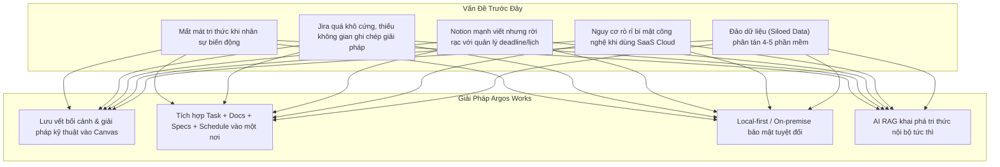

# ARGOS WORKS — TỔNG QUAN HỆ THỐNG & ĐỊNH VỊ SẢN PHẨM

> **Hệ thống Quản lý Công việc Nội bộ, Bàn giao Tri thức & Cộng tác Kỹ thuật tích hợp Trợ lý AI**  
> *(사내망 전용 — 업무 인수인계 및 AI 협업 기록 시스템)*

---

## 🎯 1. ARGOS WORKS LÀ GÌ? (PRODUCT POSITIONING)

**ARGOS WORKS** đóng vai trò là **"Bộ não kỹ thuật số trung tâm" (Central Digital Brain)** của tổ chức, được thiết kế tối ưu cho các đội ngũ kỹ sư, nghiên cứu & phát triển (R&D), và doanh nghiệp vận hành chuyên sâu với nguyên tắc **Local-first & On-premise**.

### 4 Trụ cột chức năng chính:
1. **Quản lý & Điều phối Công việc Thực thi (Work Management)**:
   - Quản lý công việc đa góc nhìn: Dạng cây phân cấp phả hệ (**Tree View**), nhóm theo nhân sự phụ trách (**Assignee View**) và danh sách phẳng (**Flat View**).
   - Lịch trình (**Schedule / Calendar**) thông minh kết hợp cả lịch cá nhân (nghỉ phép, công tác, họp) và kéo - thả (**Drag & Drop**) gán hạn chót thẻ công việc.
2. **Không gian Làm việc & Bàn giao Tri thức (Artifact Canvas & Knowledge Handover)**:
   - Mỗi thẻ công việc gắn liền với một không gian soạn thảo chuyên sâu (**Artifact Canvas**), ghi chép bối cảnh kỹ thuật, checklist, giải pháp, file log, đính kèm tài liệu.
   - Lưu vết tri thức dài hạn, đảm bảo chuyển giao công việc liền mạch giữa các thế hệ kỹ sư.
3. **Quản lý Thông tin & Đặc tả Kỹ thuật Sản phẩm (PIM - Product Specs)**:
   - Quản lý tập trung catalogue sản phẩm, bảng thông số kỹ thuật (SPEC), tài liệu firmware, hướng dẫn sử dụng theo từng model thiết bị.
4. **Hỏi đáp & Tìm kiếm Ngữ nghĩa bằng Trợ lý AI (Semantic AI Search / RAG)**:
   - Tích hợp SQLite Vector Store kết hợp mô hình AI Embedding (như Voyage AI / OpenAI / Gemini / Ollama) để tìm kiếm theo ngữ nghĩa và hỏi đáp tri thức tích lũy của doanh nghiệp.

---

## ⚡ 2. BÀI TOÁN CỐT LÕI ĐƯỢC GIẢI QUYẾT (PAIN POINTS)

* **Mất mát tri thức khi nhân sự chuyển giao (Handover Pain)**:
  * Khi nhân sự nghỉ việc hoặc luân chuyển dự án, kinh nghiệm thường chỉ nằm trong đầu cá nhân hoặc tin nhắn chat rời rạc. Người mới mất hàng tháng để nghiên cứu lại từ đầu. Argos Works biến kinh nghiệm đó thành **tài sản số vĩnh viễn** của công ty.
* **Jira / Trello quá cứng nhắc và "nông" về mặt tài liệu**:
  * Các công cụ Jira/Trello tập trung vào việc kéo vé (ticket) sang `Done`, không khuyến khích ghi lại nguyên nhân lỗi hay cách xử lý dài hạn. Argos Works bổ sung **Artifact Canvas** trực tiếp cạnh từng task.
* **Notion / Confluence thiếu tính kỷ luật vận hành**:
  * Viết tài liệu tự do nhưng không quản lý chặt chẽ được deadline thực tế, lịch nghỉ phép, ai đang làm gì hôm nay.
* **Bảo vệ tuyệt đối bí mật công nghệ (IP Protection)**:
  * Các doanh nghiệp R&D phần cứng, phần mềm nhúng, bảo mật rất e ngại việc đẩy toàn bộ mã nguồn, tài liệu thiết kế lên máy chủ đám mây (Cloud) quốc tế. Argos Works hoạt động độc lập ngay trong mạng nội bộ.

---

## 📊 3. BẢNG SO SÁNH VỚI CÁC SẢN PHẨM TRÊN THỊ TRƯỜNG

| Tiêu chí | **ARGOS WORKS** | **Jira Software** | **Notion / Confluence** | **Trello / Asana** |
| :--- | :--- | :--- | :--- | :--- |
| **Mô hình kiến trúc** | 🏠 **Local-first / On-premise** (chạy an toàn trong mạng nội bộ) | Cloud SaaS (hoặc Data Center đắt đỏ) | Hoàn toàn Cloud SaaS | Hoàn toàn Cloud SaaS |
| **Bảo mật bí mật công nghệ** | 🔒 **Cao** — dữ liệu nằm trên server công ty (PostgreSQL/SQLite); chỉ rời hạ tầng khi khách tự cấu hình AI cloud/Jira | Tiềm ẩn rủi ro chính sách Cloud | Phụ thuộc bên thứ ba | Phụ thuộc bên thứ ba |
| **Trọng tâm sản phẩm** | **Bàn giao tri thức + Quản lý thực thi kỹ thuật** | Quản lý quy trình Sprint / Issue | Soạn thảo wiki, ghi chú tự do | Kéo thẻ Kanban đơn giản |
| **Không gian làm việc (Canvas)** | **Tích hợp sẵn Artifact Canvas** bên cạnh Task (code, checklist, log) | Phải mua thêm Confluence kết nối | Khối trang tự do nhưng thiếu logic task chuẩn | Không có |
| **Khả năng AI nội bộ** | **Hỏi đáp RAG trên dữ liệu nội bộ riêng của tổ chức** | Tính phí cao, phụ thuộc Atlassian Cloud | Notion AI tính phí theo đầu người | Rất cơ bản |
| **Quản lý lịch trình (Schedule)** | **Kết hợp lịch cá nhân (nghỉ phép, họp) & kéo thả thẻ công việc** | Cần plugin mở rộng (Advanced Roadmaps) | Lịch dạng view cơ bản | Plugin (Power-Ups) |
| **Tương thích Jira** | **Đồng bộ ngầm (Silent Background Sync)**: Độc lập với Jira nhưng tự sync khi cần | Là gốc | Cần Zapier / Plugin tích hợp | Cần tích hợp rời rạc |
| **Chi phí vận hành** | **License theo hợp đồng năm** (không phí theo đầu user hàng tháng); hạ tầng do khách tự chủ | Đắt đỏ khi quy mô nhóm mở rộng | Đắt đỏ theo user/tháng | Đắt đỏ |

---

## 💎 4. GIÁ TRỊ CỐT LÕI CHO DOANH NGHIỆP

> *"Dữ liệu của công ty nằm trọn vẹn tại công ty — Kinh nghiệm của người đi trước là tài sản vĩnh viễn cho người đến sau."*

1. **Giảm đáng kể thời gian bàn giao & Onboarding**: nhân sự mới tra cứu mã thẻ hoặc hỏi Trợ lý AI để nắm ngữ cảnh công việc trong quá khứ (mức cải thiện phụ thuộc dữ liệu canvas mà đội ngũ đã ghi lại).
2. **Loại bỏ hiện tượng "Đảo dữ liệu"**: Tích hợp toàn diện Task, Canvas, Lịch trình, PIM Sản phẩm và AI Hỏi đáp trong cùng một giao diện duy nhất.
3. **Chủ quyền dữ liệu**: dữ liệu nghiệp vụ nằm trên hạ tầng doanh nghiệp. Khi cấu hình AI local (Ollama + embedding local) và không bật Jira connector, hệ thống có thể vận hành trong mạng nội bộ/air-gap mà không cần Internet.
