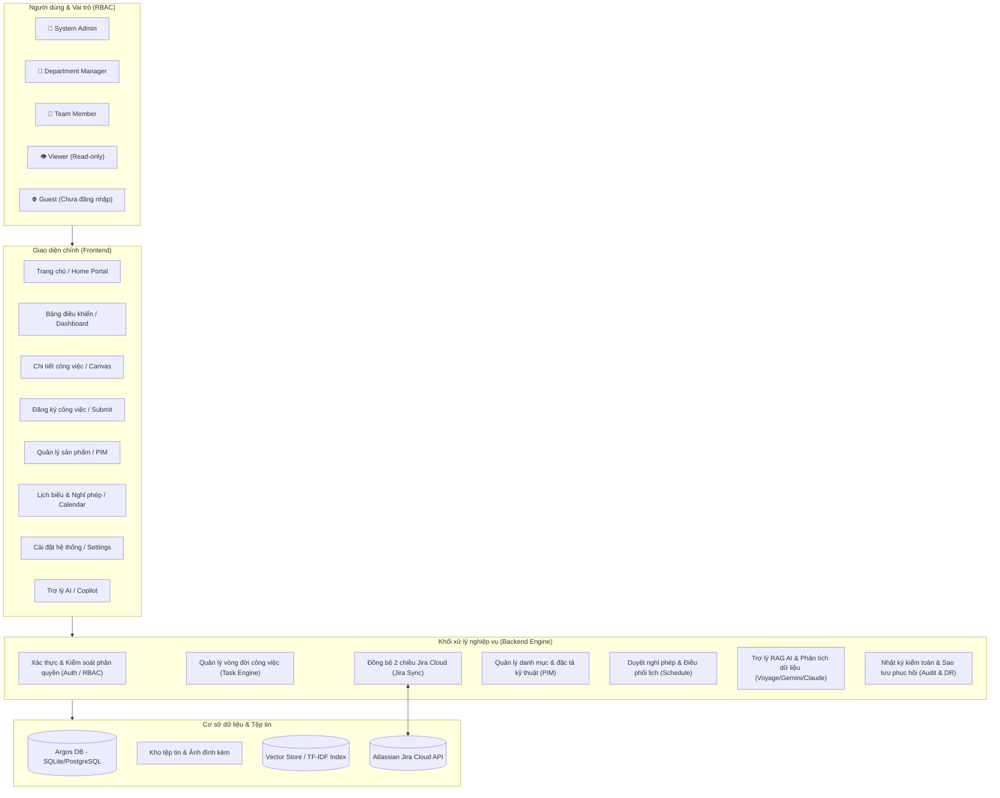
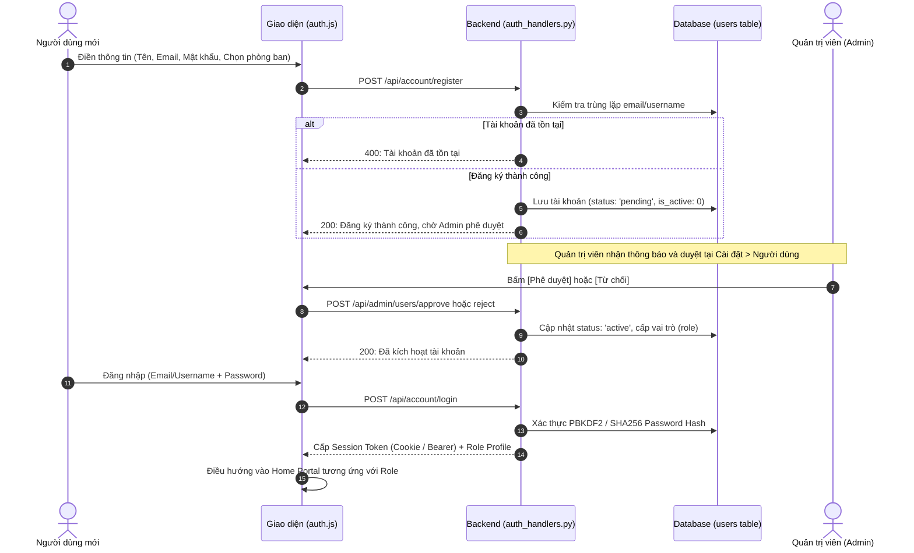
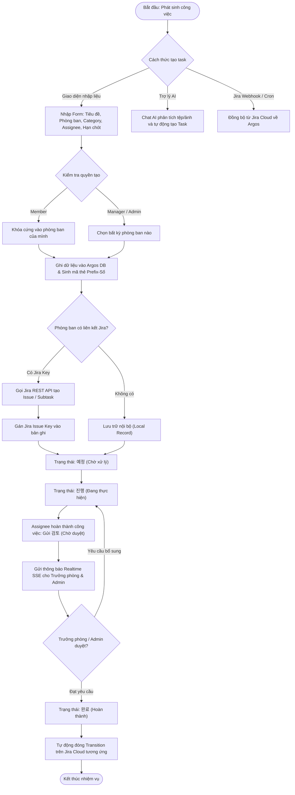
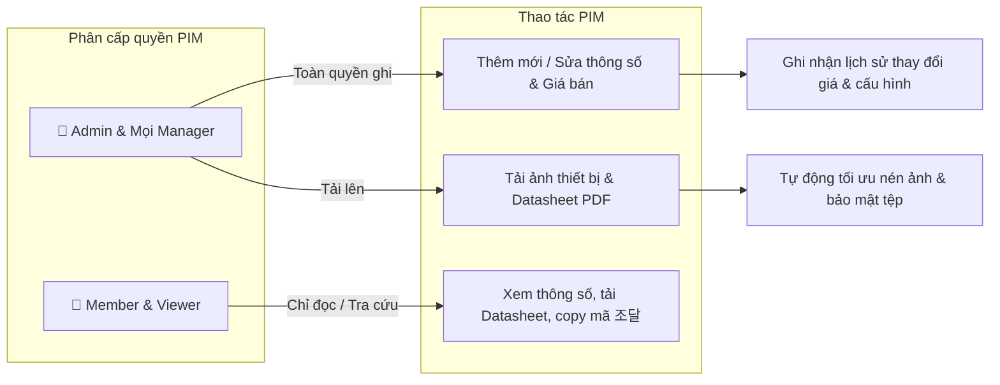
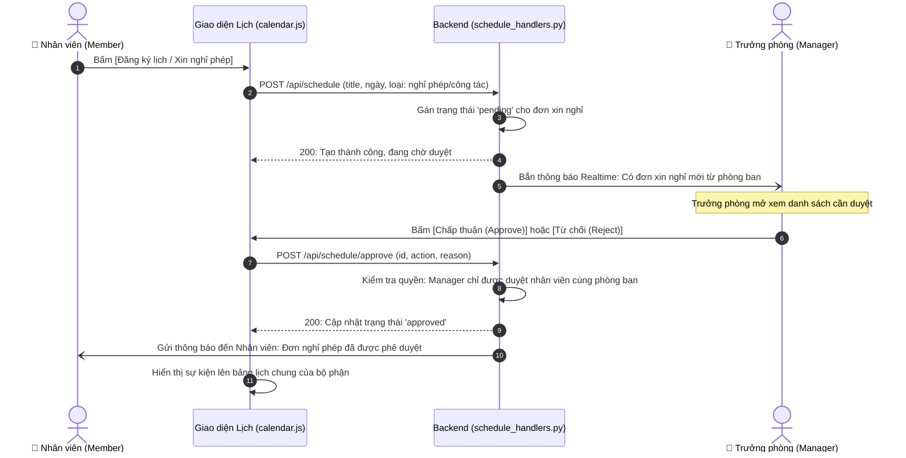
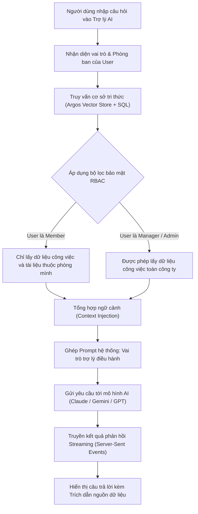
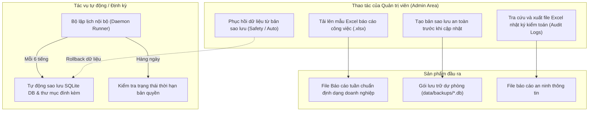

# SƠ ĐỒ VÀ ĐẶC TẢ LUỒNG NGHIỆP VỤ TOÀN DIỆN (ARGOS WORKS)

Hệ thống **ARGOS WORKS** là nền tảng quản trị công việc nội bộ, số hóa thông số kỹ thuật sản phẩm (PIM), điều hành lịch biểu và trợ lý AI doanh nghiệp được tích hợp hai chiều với **Atlassian Jira Cloud**.

Tài liệu này hệ thống hóa toàn bộ các luồng nghiệp vụ chính của hệ thống từ lúc khởi tạo người dùng cho đến khi vận hành và quản trị.

---

## 1. Bản đồ tổng thể hệ thống (System Architecture Overview)

---

## 2. Luồng 1: Xác thực, Đăng ký & Phê duyệt tài khoản (User Onboarding & Approval)

Mọi tài khoản đăng ký mới đều phải trải qua luồng phê duyệt an toàn bởi Quản trị viên hệ thống để ngăn ngừa truy cập trái phép.

---

## 3. Luồng 2: Vòng đời công việc & Đồng bộ Jira Cloud (Task Lifecycle & Sync)

---

## 4. Luồng 3: Quản trị sản phẩm & Đặc tả thông số kỹ thuật (PIM Workflow)

Hệ thống PIM là nơi lưu trữ danh mục thiết bị phần cứng, giải pháp AI, mã đăng ký đấu thầu nhà nước (조달) và tài liệu kỹ thuật.

---

## 5. Luồng 4: Điều phối Lịch biểu & Phê duyệt nghỉ phép (Calendar & Leave Approval)

---

## 6. Luồng 5: Trợ lý AI Thông minh & Bảo vệ dữ liệu RAG (AI Copilot Engine)

Trợ lý ảo AI sử dụng công nghệ tìm kiếm kết hợp (Hybrid Search: Vector Embedding + Fulltext) và tuân thủ tuyệt đối phạm vi phân quyền của người hỏi:

---

## 7. Luồng 6: Quản trị hệ thống, Báo cáo & Phục hồi sau thảm họa (Disaster Recovery & Governance)

---

## 8. Ma trận đối chiếu Quyền hạn & Tính năng (RBAC Matrix)

| Chức năng nghiệp vụ | Quản trị viên (`admin`) | Trưởng phòng (`manager`) | Nhân viên (`member`) | Khách nội bộ (`viewer`) |
| :--- | :---: | :---: | :---: | :---: |
| **Tạo Task mới** | Bất kỳ phòng nào | Bất kỳ phòng nào | Khóa cứng phòng mình | ❌ Không có quyền |
| **Chỉnh sửa thông tin Task** | Toàn bộ | Chỉ sửa việc phòng mình | Chỉ sửa việc do mình phụ trách | ❌ Không có quyền |
| **Duyệt hoàn thành Task (`완료`)** | Toàn bộ | Chỉ duyệt việc phòng mình | ❌ Cần gửi `검토` cho sếp | ❌ Không có quyền |
| **Xóa Task** | Toàn bộ | Chỉ xóa việc phòng mình | ❌ Không có quyền | ❌ Không có quyền |
| **Đẩy Task sang Jira Cloud** | ✅ Có | ✅ Chỉ việc phòng mình | ❌ Không có quyền | ❌ Không có quyền |
| **Quản trị sản phẩm (PIM)** | Toàn quyền | Toàn quyền (Tất cả Manager) | Chỉ xem | Chỉ xem |
| **Duyệt nghỉ phép (Calendar)** | Toàn quyền | Duyệt nhân viên phòng mình | ❌ Chỉ được tạo đơn | ❌ Không có quyền |
| **Truy cập Tab Cài đặt (Settings)** | Toàn bộ 9 mục | Chỉ 2 mục (Template & Quy cách sản phẩm) | ❌ Ẩn tab | ❌ Ẩn tab |
| **Sao lưu & Phục hồi DB (DR)** | Toàn quyền | ❌ Ẩn tab | ❌ Ẩn tab | ❌ Ẩn tab |
| **Trợ lý AI tra cứu chéo phòng ban** | Được phép | Được phép | ❌ Chỉ tra cứu việc phòng mình | ❌ Chỉ tra cứu public |
