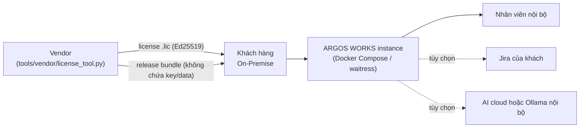

# ARGOS WORKS — Mô hình bán B2B On-Premise & Quy trình bàn giao

> **Phiên bản sản phẩm:** 1.0.0
> **Mô hình:** B2B On-Premise / Private Cloud License (1 khách = 1 instance)
> **Đối tượng:** doanh nghiệp công nghệ, sản xuất, R&D cần tập trung dữ liệu công việc,
> tài liệu kỹ thuật và tri thức nội bộ, có hoặc không dùng Jira.

---

## 1. Mô hình kinh doanh

| Hạng mục | Nội dung |
|---|---|
| **Cấp phép** | License offline ký số **Ed25519**: tên khách hàng, số ghế, ngày hết hạn, danh sách module |
| **Đóng gói** | Gói SME (10–50 ghế), Enterprise (50+), module bán rời (PIM / Jira / RAG / Schedule / Audit) |
| **Bàn giao** | Bundle sạch (`dist/argos-works-<version>.zip`) + tài liệu + license key |
| **Dữ liệu** | Nằm hoàn toàn trên hạ tầng khách; vendor không có kết nối ngược |
| **Hết hạn** | Hệ thống chuyển **read-only**, **không** khoá/xoá dữ liệu khách |



---

## 2. Sản phẩm gồm những gì (đúng theo code hiện tại)

| Module | Nội dung | Mã trong license |
|---|---|---|
| Work & Canvas | Quản lý công việc (cây phân cấp, kanban, assignee), canvas ghi chú/đính kèm | `canvas` (luôn có) |
| PIM | Danh mục sản phẩm, thông số kỹ thuật, thông tin mua sắm, tài liệu | `pim` |
| Jira | Đồng bộ issue/comment/attachment, chuyển trạng thái, lịch deadline | `jira` |
| AI RAG | Trợ lý hội thoại + tìm kiếm ngữ nghĩa trên dữ liệu nội bộ | `rag` |
| Schedule | Lịch cá nhân (nghỉ phép/công tác/họp) + deadline công việc | `schedule` |
| Audit | Nhật ký kiểm toán + xuất CSV/JSON | `audit` |

Hạ tầng: Python 3.10+ (stdlib HTTP + WSGI `waitress`/`gunicorn`), PostgreSQL 14+ hoặc
SQLite (≤ 20–30 user đồng thời), Caddy/Nginx cho HTTPS, Docker Compose có sẵn.

> Module không nằm trong license bị chặn ở tầng API (HTTP 403, mã `MODULE_NOT_LICENSED`),
> không chỉ ẩn trên UI.

---

## 3. Quy trình bàn giao

### Bước 1 — Phát hành license (chỉ vendor)

```bash
# Lần đầu: sinh cặp khoá. Private key lưu offline, KHÔNG commit, KHÔNG gửi khách.
python tools/vendor/license_tool.py keygen

# Cấp license cho khách
python tools/vendor/license_tool.py issue \
    --customer "ACME Manufacturing" \
    --seats 40 --expiry 2027-12-31 \
    --modules canvas,pim,jira,rag,schedule,audit \
    --out licenses/ACME-2027.lic

# Kiểm tra trước khi gửi
python tools/vendor/license_tool.py inspect licenses/ACME-2027.lic
```

- Bản khách hàng **chỉ chứa public key**; không có `tools/vendor/`.
- Mọi lần phát hành được ghi vào `tools/vendor/issued_licenses.csv` (không commit) để đối soát doanh thu.

### Bước 2 — Đóng gói bản giao

```bash
python scripts/build_release.py --include-docs
# -> dist/argos-works-1.0.0.zip
```

Script tự loại `data/`, `logs/`, `server/config.json`, `*.db`, `tools/vendor/`, `tests/`
và **dừng build** nếu phát hiện private key hoặc database lọt vào bundle.

### Bước 3 — Khách hàng triển khai

```bash
cp .env.example .env        # ARGOS_MASTER_KEY, DATABASE_URL, DOMAIN, ALLOW_PUBLIC_REGISTER=false
docker compose up -d --build
```

1. Mở `https://<domain>/setup.html`, dán license key.
2. Tạo Admin đầu tiên, khai báo phòng ban.
3. Bật backup (`BACKUP_DIR`) và trỏ ra NAS/ổ ngoài.

Nếu không có Internet: dùng `python scripts/apply_license.py <file>.lic` rồi restart.

---

## 4. Tài liệu đi kèm hợp đồng

| Tài liệu | Đối tượng |
|---|---|
| `docs/ADMIN_GUIDE.md` | IT Admin: cài đặt, RBAC, license, backup/restore, nâng cấp, xử lý sự cố |
| `docs/USER_GUIDE.md` | Người dùng cuối |
| `docs/DEPLOYMENT.md` | DevOps: Docker, HTTPS, service manager, build release, license ops |
| `docs/SECURITY_WHITEPAPER.md` | CISO/CTO: mô hình bảo mật + **giới hạn đã biết** |
| `docs/SLA.md` | Mẫu SLA P1–P3, trách nhiệm hai bên |
| `docs/EULA.md` | Điều khoản cấp phép + cam kết dữ liệu |
| `CHANGELOG.md` | Lịch sử phiên bản (semver) |

---

## 5. Điều cần nói rõ với khách (không hứa quá)

1. **AI cloud**: nếu khách cấu hình Gemini/OpenAI/Claude, nội dung truy vấn sẽ rời hạ tầng khách.
   Muốn "không ra ngoài" thì dùng Ollama + embedding local và **không** cấu hình key cloud.
2. **SQLite** chỉ phù hợp tới ~20–30 user đồng thời; trên ngưỡng phải PostgreSQL.
3. **Jira connector** phụ thuộc API/rate limit của Atlassian, không cam kết realtime.
4. **MFA/LDAP/SAML** chưa có trong 1.0.0 (chỉ có nền SSO OIDC); **i18n tiếng Việt** chưa hoàn thiện.
5. Chưa có **pentest bên thứ ba** cho 1.0.0 — nên thực hiện trước khi bán cho tập đoàn.
